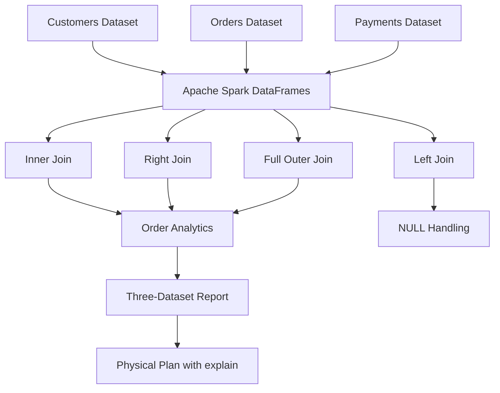

# 🔗 Day 18 — Spark Joins

<p align="center">
  <b>Orders, Customers & Payments Analytics</b><br/>
  Scala + Apache Spark Practice Project
</p>


## 📌 Overview

This project demonstrates four major join types using Spark DataFrames. It combines customer, order, and payment information, handles missing records, and inspects Spark's physical execution plan.

## 🏗️ Architecture



## 🔄 Workflow

1. Create sample customer, order, and payment datasets.
2. Join customers with orders using `customer_id`.
3. Demonstrate inner, left, right, and full outer joins.
4. Use DataFrame aliases to avoid ambiguous column references.
5. Handle missing order amounts using `coalesce()`.
6. Join orders and payments using `order_id`.
7. Combine all three datasets into a complete order report.
8. Inspect Spark's execution strategy with `explain(true)`.

## 🛠️ Tech Stack

| Technology | Version / Purpose |
|---|---|
| Scala | 2.12.18 |
| Apache Spark | 3.5.3 |
| Java | 17 |
| sbt | 1.12.15 |
| Spark SQL | DataFrame joins and query planning |

## 🔍 Join Types

| Join | Result |
|---|---|
| Inner | Only matching records |
| Left outer | Every left record plus matching right records |
| Right outer | Every right record plus matching left records |
| Full outer | All records from both sides, with NULL for unmatched values |

## 🧹 NULL Handling

The project uses:

- `coalesce()` to replace missing order amounts with `0.0`.
- `when()` to label customers as `Ordered` or `No Order`.
- Aliases such as `c`, `o`, and `p` to qualify columns and avoid ambiguity.

**Important:** Replacing a missing amount with zero is a reporting choice; it does not mean a real order worth zero occurred.

## ⚙️ Spark Physical Join Strategies

The execution plan showed:

- **Sort Merge Join** for the full outer customers-orders join. Spark repartitions and sorts join keys before merging matching keys.
- **Broadcast Hash Join** for the left orders-payments join. Spark broadcasts the smaller side to avoid shuffling both sides for that join.

Spark's chosen physical plan can vary with dataset size, statistics, configuration, and join type.

## 📁 Project Structure

```text
Day-18-Joins/
├── src/main/scala/
│   └── OrdersCustomersPayments.scala
├── project/
│   └── build.properties
├── .gitignore
├── build.sbt
└── README.md
```

## ▶️ Run the Project

Compile:

```bash
sbt clean compile
```

Run:

```bash
sbt "runMain OrdersCustomersPayments"
```

## 🧠 Learning Outcomes

- Implemented inner, left, right, and full outer joins.
- Practiced aliases and qualified column references.
- Handled NULL values after left joins.
- Joined three related datasets.
- Read Spark's logical and physical execution plans.
- Learned the difference between Sort Merge Join and Broadcast Hash Join.

---

**Author:** Harsha  
**Learning Series:** Scala + Apache Spark — 30 Days of Daily Practice
